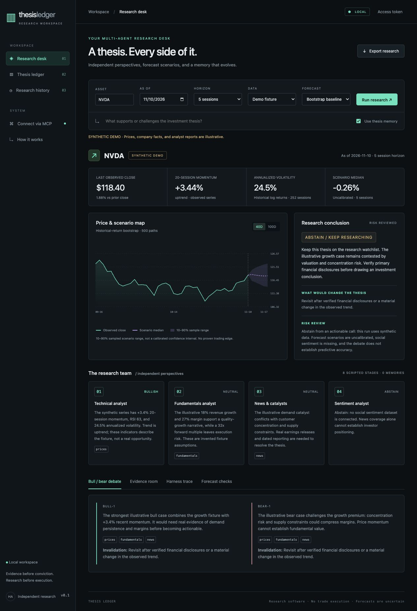
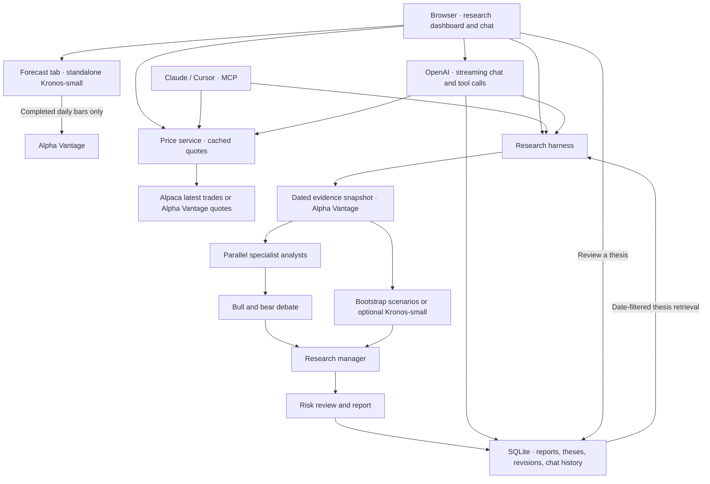

# Thesis Ledger

I built Thesis Ledger to ask questions about U.S. stocks, compare bull and bear cases, and revisit investment theses as the evidence changes. The dashboard streams OpenAI responses, displays the latest available market price, and opens the same research workflow that Claude and Cursor can call over MCP.



## Run locally

```sh
uv sync --extra dev
cp -n .env.example .env
uv run thesis-ledger
```

Open [localhost:8000](http://127.0.0.1:8000). Choose **Research chat** for a conversation or **Research desk** for a structured run. Use **Forecast** to run Kronos on its own. Demo research uses synthetic data and works without credentials.

| Feature | Environment |
|---|---|
| Streaming chat and live analyst reports | `OPENAI_KEY` or `LLM_API_KEY`. The default model is `gpt-4o-mini`. Set `LLM_MODEL` to override it. |
| Daily bars, fundamentals, news, and end-of-day prices | `ALPHA_VANTAGE` or `ALPHAVANTAGE_API_KEY` |
| Intraday latest trades | `APCA_API_KEY_ID` and `APCA_API_SECRET_KEY`. `LEDGER_ALPACA_FEED` defaults to `iex`. |
| Alpha Vantage real-time quote polling | `LEDGER_AV_REALTIME=1`, with a key entitled to real-time US quotes |
| Optional Kronos scenarios | Follow [Kronos setup](docs/kronos.md) to install the dependencies and weights. |

The app loads `.env` from the working directory. After installing the optional Kronos dependencies, start with `uv run --no-sync thesis-ledger` to preserve them. For a first session, try “What’s the latest available NVDA price?” or “Run a research report on NVDA and summarize the bear case.” Saved report IDs can be used in follow-up questions. Free Alpha Vantage quotas can limit the number of live reports. The panel shows whether a price is end-of-day or from an intraday feed, with its observation time.

## Architecture



I keep forecasts separate until synthesis so analysts can form and challenge a thesis before seeing the projected paths. The manager combines the arguments with the forecast, and risk review can abstain. The ledger records the evidence and when it became available so future research can retrieve the right version of a thesis. See [architecture and decisions](docs/architecture.md).

## MCP and hosting

The app exposes Streamable HTTP MCP at `/mcp/`. It also supports local stdio through `uv run thesis-ledger-mcp`. The tools cover the latest price, research, saved reports, recovery, thesis search, and thesis review. See the [deployment and MCP guide](docs/deployment.md) for client configuration and a free Render deployment. SQLite persists on local disk; Render's free filesystem is ephemeral.

## Papers that inspired this project

- [TradingAgents](https://arxiv.org/abs/2412.20138) inspired the specialist team, bull/bear debate, and risk review.
- [Kronos](https://arxiv.org/abs/2508.02739) provides the optional candlestick forecast.
- [SimpleMem](https://arxiv.org/abs/2601.02553) inspired compact thesis records and selective retrieval.
- [ReHarness](https://arxiv.org/abs/2610.12668) inspired revisiting prior theses while preserving the evidence behind them.

See [research notes](docs/research.md) for the adaptations and [evaluation notes](docs/evaluation.md) for validation limits. Run the local test suite with `uv run pytest -q`.
