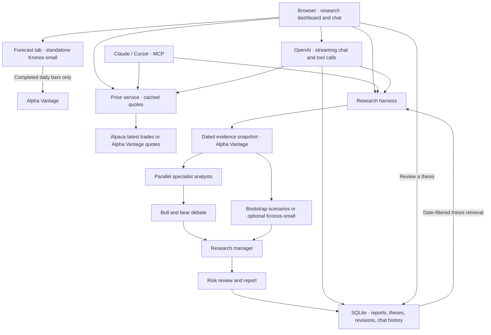

# Thesis Ledger

I built Thesis Ledger to ask questions about U.S. stocks, compare bull and bear cases, and revisit investment theses as the evidence changes. The dashboard streams OpenAI responses, shows market moves and sourced headlines, and opens the same research workflow that Claude and Cursor can call over MCP.

Currently being hosted: https://thesis-ledger.onrender.com/


## Run locally

```sh
uv sync --extra dev
cp -n .env.example .env
uv run thesis-ledger
```

Open [localhost:8000](http://127.0.0.1:8000). Choose **Research chat** for a conversation or **Research desk** for a structured run. Use **Forecast** to explore historical-return scenarios or run Kronos when installed.

| Feature | Environment |
|---|---|
| Streaming chat and live analyst reports | `OPENAI_KEY` or `LLM_API_KEY`. The default model is `gpt-4o-mini`. Set `LLM_MODEL` to override it. |
| Daily bars, fundamentals, news, and end-of-day prices | `ALPHA_VANTAGE` or `ALPHAVANTAGE_API_KEY` |
| Intraday latest trades | `APCA_API_KEY_ID` and `APCA_API_SECRET_KEY`. `LEDGER_ALPACA_FEED` defaults to `iex`. |
| Alpha Vantage real-time quote polling | `LEDGER_AV_REALTIME=1`, with a key entitled to real-time US quotes |
| Optional Kronos scenarios | Follow [Kronos setup](docs/kronos.md) to install the dependencies and weights. |

The app loads `.env` from the working directory. After installing the optional Kronos dependencies, start with `uv run --no-sync thesis-ledger` to preserve them. For a first session, try “What’s the latest available NVDA price?” or “Run a research report on NVDA and summarize the bear case.” Saved report IDs can be used in follow-up questions. Free Alpha Vantage quotas can limit the number of live reports. The panel shows whether a price is end-of-day or from an intraday feed, with its observation time.

## Architecture



I keep forecasts separate until synthesis so analysts can form and challenge a thesis before seeing the projected paths. The manager combines the arguments with the forecast, and risk review can abstain. The ledger records the evidence and when it became available so future research can retrieve the right version of a thesis. See [architecture and decisions](docs/architecture.md).

## MCP and hosting

The hosted app exposes public market tools at `/mcp/public/`. The full toolkit is available through the token-protected `/mcp/` endpoint or local stdio with `uv run thesis-ledger-mcp`. The tools cover the market brief, latest price, research, saved reports, recovery, thesis search, and thesis review. See the [deployment and MCP guide](docs/deployment.md) for client configuration and a free Render deployment. SQLite persists on local disk; Render's free filesystem is ephemeral.

## Papers that inspired this project

- [TradingAgents](https://arxiv.org/abs/2412.20138) inspired the specialist team, bull/bear debate, and risk review.
- [Kronos](https://arxiv.org/abs/2508.02739) provides the optional candlestick forecast.
- [SimpleMem](https://arxiv.org/abs/2601.02553) inspired compact thesis records and selective retrieval.
- [ReHarness](https://arxiv.org/abs/2610.12668) inspired revisiting prior theses while preserving the evidence behind them.

See [research notes](docs/research.md) for the adaptations and [evaluation notes](docs/evaluation.md) for validation limits. Run the local test suite with `uv run pytest -q`.

The Market desk shows a curated watchlist of index ETFs and large-cap stocks. Select a row or enter another U.S. ticker to change the chart, company headlines, and report. With Alpaca configured, the chart shows five-minute candles for the most recent regular trading session with bars. Company headlines also feed into newly generated research.

### Durable research history on Render

Thesis Ledger can store research reports, thesis memories, and revisions in
Supabase Postgres. The website and authenticated research MCP use the same
backend. Public visitors keep separate records through their signed browser
cookie. Keep `LEDGER_API_TOKEN` stable across deploys so existing cookies
continue to resolve to the same workspace.

1. Apply the SQL migration in `supabase/migrations/` through Supabase.
2. Create a dedicated login in the Supabase SQL editor with a generated
   password, then grant it membership in the migration's application role.

   ```sql
   CREATE ROLE thesis_ledger_render LOGIN PASSWORD '<generated-password>';
   GRANT thesis_ledger_app TO thesis_ledger_render;
   ```

3. In the Supabase **Connect** panel, copy the **Session pooler** connection
   URI. Use `thesis_ledger_render.<project-ref>` as its username, replace the
   password with the URL-encoded generated password, and add
   `?sslmode=require`. For certificate and hostname validation, supply the
   Supabase CA certificate on the host and use `sslmode=verify-full`.
4. Save the URI as the secret `LEDGER_DATABASE_URL` in the Render service's
   **Environment** settings and redeploy.

With no database URL, the app uses SQLite. Existing SQLite research records
stay in their original database. Chat transcripts, forecast cache, and daily
usage counters continue to use the host's local storage.

### Google sign-in

The hosted site uses Supabase Auth with Google for browser accounts. Set up a
Google OAuth web client and add the Supabase callback shown in the Google
provider settings as an authorized redirect URI. Save the Google client ID
and secret in **Supabase → Authentication → Sign In / Providers → Google**.
For the existing project, the Google redirect URI is
`https://xforbxaqhicjolgdgvxx.supabase.co/auth/v1/callback`.
Follow the [Supabase Google setup guide](https://supabase.com/docs/guides/auth/social-sign-in/auth-google)
to configure the Google consent screen and test users or publishing status.

In **Supabase → Authentication → URL Configuration**, allow the app callback
`https://thesis-ledger.onrender.com/auth/callback`. Set these environment
variables in Render after enabling the Google provider:

- `SUPABASE_URL=https://xforbxaqhicjolgdgvxx.supabase.co`
- `SUPABASE_PUBLISHABLE_KEY` from the Supabase project API keys screen
- `LEDGER_SITE_URL=https://thesis-ledger.onrender.com`

Keep `LEDGER_DATABASE_URL` configured for durable storage. Signed-in runs
are stored under the verified Supabase account ID. Google sign-in lasts up to
one hour before the app asks the visitor to sign in again. Guest reports use
a browser session and local storage on the server. Old guest runs are not
attached to a Google account. Open a completed run from the ledger or
Research History to view the full report and download its Markdown.
