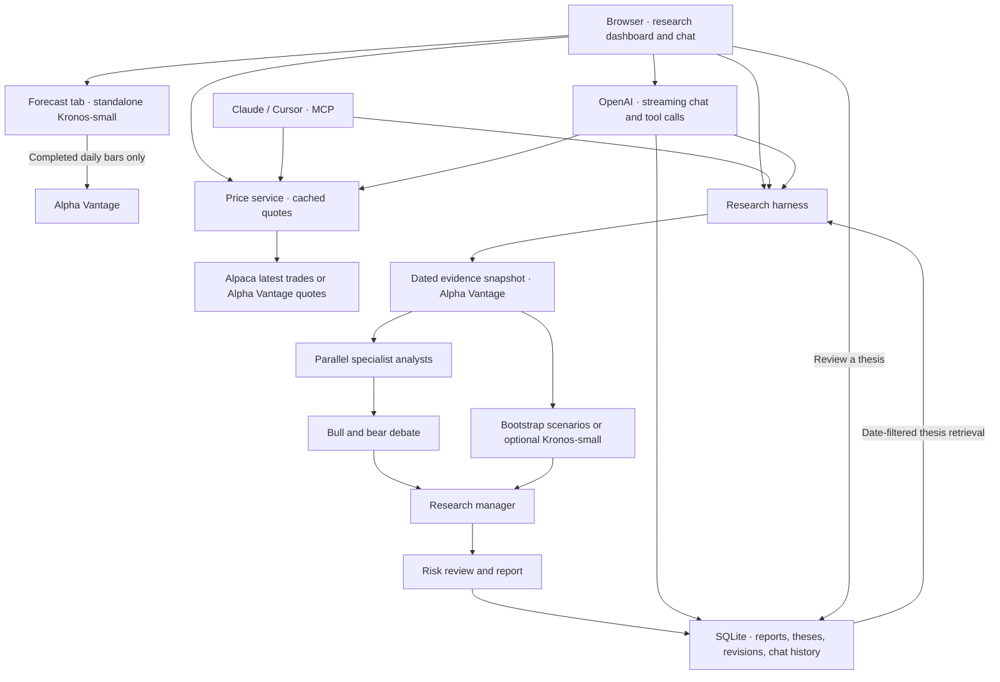

# Architecture and decisions

## Product boundary

I built Thesis Ledger as a single-user research workbench that runs locally or on a hosted Python service. The output is an inspectable thesis, counterarguments, evidence, forecast scenarios, and limitations. It neither executes trades nor sizes a user's portfolio. There is no claim of profitable performance.

## Why a bounded multi-agent workflow?

TradingAgents supplies a strong organizational idea: separate information gathering from opposing research arguments and risk review. I retain four specialist roles, bull/bear researchers, a synthesizer, and a risk reviewer. This is a developer-controlled workflow with role-specific LLM calls, not an unconstrained agent selecting arbitrary tools. The first implementation values auditability over open-ended autonomy.

A fixed source adapter gathers market, company, and news data. Four analyst calls run concurrently. They share a bounded snapshot rather than a full conversation. A bull and bear debate sequentially for one or two rounds. The manager then sees the forecast; the risk reviewer can veto an actionable stance. Forecast disagreement is surfaced separately.

I avoid majority voting: correlated LLM outputs are not independent statistical evidence. “Confidence” percentages are intentionally absent.

## The custom twist: independent forecasts and a thesis ledger

1. **Late forecast fusion.** Initial analysts do not see forecast trajectories. This reduces anchoring, but does not prove independence: they still share sources and possibly a backbone model.
2. **Compact, attributable memory.** Store thesis, stance, invalidation, regime, asset, source IDs, originating run, market date, and actual write time. Full runs remain inspectable.
3. **Revision without time travel.** Feedback appends a narrowing or retirement event. Original claims and reports remain unchanged. Retrieval applies both market dates and availability dates; later revisions cannot affect earlier-date retrieval.
4. **Abstention is a first-class outcome.** Synthetic runs always abstain; stale data and a risk veto also force abstention. Missing social data is explicitly reported.

## Memory implementation versus the papers

The SQLite ledger implements structured compression through the validated manager summary, a compact fixed-field record, and deduplication by originating run. Retrieval uses asset/mode/date filters plus BM25 keyword ranking, capped at four memories. It does **not** implement SimpleMem's dense embeddings, multi-index fusion, or LLM intent planner. Structured reports reduce integration complexity but are not guaranteed “lossless.”

ReHarness-inspired revisions are deliberately conservative: users can narrow applicability to the original source snapshot or retire a memory. Feedback is stored as unverified metadata and not inserted into the original claim. This does **not** implement automated source-grounded backward reflection, reward optimization, or outcome settlement. No learning-performance claim is made.

## Chat and market prices

I stream OpenAI replies over the same authenticated API that serves the dashboard. Chat can look up a price, open a saved report, or start the existing research harness. I store completed exchanges in SQLite and use the latest 16 messages as model context. Thesis edits go through the explicit review controls.

The price panel and MCP share a quote service. With Alpaca credentials, the browser refreshes the latest trade every 15 seconds while the chat page is open. With Alpha Vantage real-time entitlement it polls every 60 seconds. The standard Alpha Vantage key returns an end-of-day quote on demand. The interface shows the feed and observation time. Research snapshots still use completed daily bars, so an intraday quote never becomes a partial daily candle.

The Forecast tab fetches daily bars and runs Kronos directly. It skips the analyst team and the extra requests for fundamentals and news.

The landing page shows a market brief across major index ETFs and large-cap stocks. The dashboard, chat, and MCP share cached quotes and sourced CNBC Markets, Federal Reserve, and Bureau of Labor Statistics headlines. The first visit shows the last completed live NVDA report and runs a fresh daily report when needed. The Forecast tab loads a cached or newly computed Kronos result on entry.

## State and recovery

SQLite uses WAL and parameterized SQL. A run stores its request, source snapshot, metrics, retrieved memories, forecast, validated reports, trace, attempt counter, and terminal status. Each successful report is checkpointed. Resume reuses successful stages and keeps the original source snapshot, avoiding mixed-date source retrieval and repeated completed model calls. Reopening a completed run is idempotent and does not create duplicate memories.

The app uses one shared in-process harness lock for HTTP and HTTP MCP. A separate stdio process shares SQLite but has its own lock; run IDs isolate state. Deploy one worker in this prototype. A production queue with transactional job leases is a future extension.

There are at most 16 model attempts across resumes, at most two debate rounds, bounded output schemas, and a 240-second orchestration deadline per execution attempt. Provider requests have timeouts. Kronos runs in a separate child process that is killed after 180 seconds; its stdout cannot corrupt stdio MCP. The call cap is not a monetary budget; provider pricing and prompt context vary. A failed provider call counts toward the cap. There is no automatic retry storm.

## Quality and trust boundaries

- Validate OHLCV, dates, uniqueness, finite numbers, symbol syntax, horizon, role schemas, and citation membership.
- Unknown source IDs reject a report. Citation membership does not establish that the source entails a claim; human review and an entailment evaluation remain needed.
- Sources, questions, and memories are data inside a lower-trust context. Prompts instruct models not to execute embedded commands. There is no model-accessible shell, network executor, or trading tool.
- Render model content as escaped text; source URLs permit only HTTP(S).
- Secrets are environment-only. Provider errors are sanitized so API-key-bearing URLs do not enter persistent traces.
- Host validation and origin checks protect localhost from basic cross-site requests. Remote binding requires a token; shared-token deployment is single-user, not tenant isolation or OAuth.

## Temporal limitations

Alpha Vantage current overview is not historical point-in-time data, so it is excluded for historical requests. News is also excluded there in this first version. Daily candles exclude today and use an NYSE session calendar; other exchanges and intraday assets are out of scope. Data is unadjusted, so splits/dividends may invalidate metrics. Corporate-action-aware ingestion is needed before serious market evaluation.

Historical LLM evaluations can still contain knowledge learned during model pretraining. Filtering input dates cannot prove that the model lacks future knowledge. The bundled evaluation is price-only and does not claim to eliminate that problem for LLM strategies.

## Next experiments

Compare no memory, append-only memory, and reviewed memory on a dated research dataset. Compare forecast-hidden versus forecast-visible analysts. Measure unsupported claims, citation entailment, abstention quality, context size, latency, and cost. Separately evaluate Kronos against naive and bootstrap baselines with embargoed rolling windows, corporate-action handling, and frozen model/data versions. Add outcome settlement only once execution timing and immutable source availability are defined.
